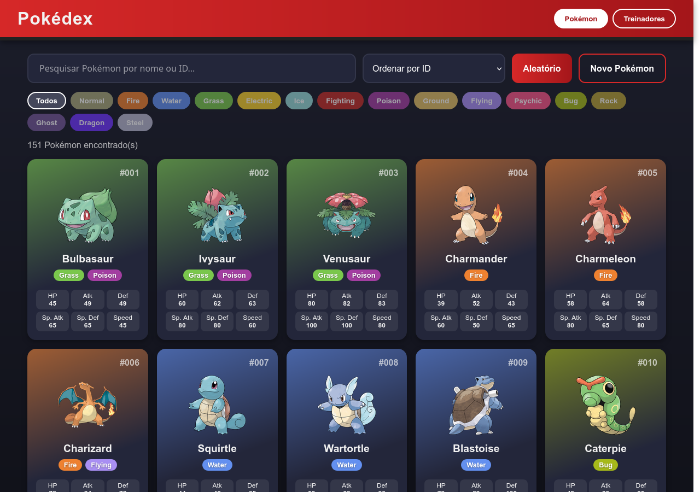
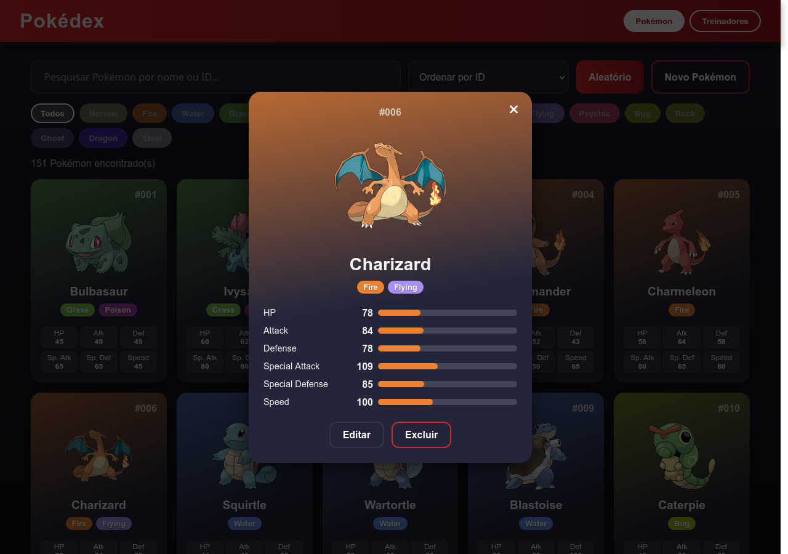
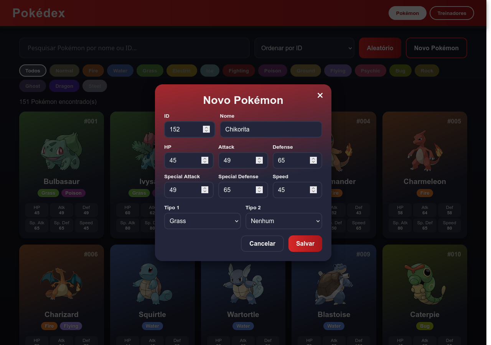
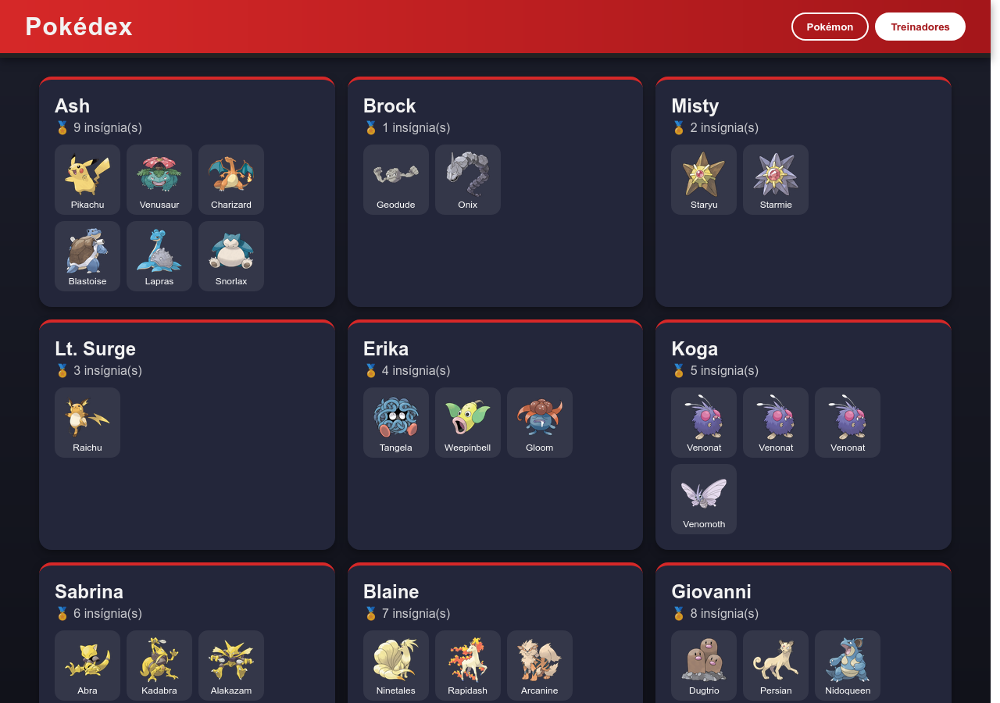
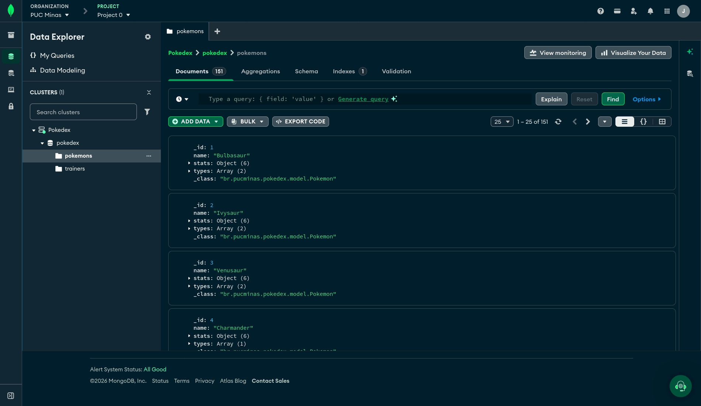

# Pokédex Full Stack com Spring Boot + MongoDB

Evolução da [Pokédex da Atividade 03](../Pokedex): o frontend em React deixa de ler um arquivo JSON local e passa a consumir uma API REST feita com Spring Boot, que guarda os Pokémon e os treinadores no MongoDB Atlas. Além de pesquisar, filtrar e ver os detalhes, agora é possível cadastrar, editar e excluir Pokémon pela interface.

**Autor:** [João Mário Paes de Abreu](https://github.com/joaom-abreu)

### Dependências Utilizadas

**Backend**
- Java 25
- Spring Boot 4.2.0 (Spring Web, Spring Data MongoDB e Validation)
- MongoDB Atlas

**Frontend**
- Node.js 22
- React 19
- Vite 8

**Conversão dos dados**
- Python 3 (só a biblioteca padrão)

---

### Arquitetura

```text
React (frontend)  ──HTTP/JSON──▶  Controller ──▶ Service ──▶ Repository ──▶ MongoDB Atlas
                                  └──────────── Spring Boot (backend) ──────────┘
```

- **Controller:** recebe as requisições HTTP, valida o corpo com `@Valid` e devolve os status corretos (`201`, `204`, `404`...).
- **Service:** regras de negócio, como impedir o cadastro de um id que já existe e garantir que o PUT use o id da URL.
- **Repository:** interfaces que estendem `MongoRepository`; o Spring Data gera as consultas.
- **Model:** `record`s Java mapeados para as coleções `pokemons` e `trainers`, com as anotações de validação.
- **Exception:** um `@RestControllerAdvice` transforma as exceções em respostas no formato `ProblemDetail`.
- **Config:** liberação de CORS para o frontend e carga inicial dos dados (`DataSeeder`).

O frontend concentra todas as chamadas à API em `src/services/api.js`. Pesquisa, filtro por tipo, ordenação e sorteio continuam sendo feitos no navegador, sobre a lista carregada da API.

---

### Funcionalidades

- Lista dos Pokémon carregada da API, com tela de carregamento e mensagem de erro quando a API está fora do ar
- Pesquisa por nome ou ID, filtro por tipo e ordenação por ID, nome ou atributo
- Modal de detalhes com barras de atributos
- Botão para sortear um Pokémon aleatório entre os exibidos
- Cadastro de Pokémon em um formulário com validação (ID, nome, 6 atributos e 1 ou 2 tipos)
- Edição de Pokémon pelo modal de detalhes, com o formulário preenchido
- Exclusão de Pokémon com confirmação
- Mensagens de erro da API exibidas na tela (ex.: ID já cadastrado)
- Imagem genérica para Pokémon cadastrados com ID acima de 151
- Aba de treinadores carregada do MongoDB, que ignora Pokémon excluídos

---

### Prints

|  |
|:----------------------------------------------------:|
|                   Lista de Pokémon                   |

|  |
|:----------------------------------------------------:|
|           Detalhes, com Editar e Excluir             |

|  |
|:----------------------------------------------------:|
|              Formulário de cadastro                  |

|  |
|:----------------------------------------------------:|
|                     Treinadores                      |

|  |
|:----------------------------------------------------:|
|      Coleções `pokemons` e `trainers` no Atlas       |

---

### Modelagem: do SQL para o MongoDB

Os dados vêm do `Script_Pokedex.sql`, que modela a Pokédex em tabelas relacionais. O script `database/sql_to_json.py` converte esse SQL em dois arquivos JSON (`backend/src/main/resources/data/`), que o `DataSeeder` insere no MongoDB na primeira execução.

| SQL | MongoDB | Por quê |
|-----|---------|---------|
| `Pokemon` | coleção `pokemons`, com `_id` = número da Pokédex | o número já identifica o Pokémon e é usado na URL e na imagem |
| colunas `HP`, `Attack`, ... | subdocumento `stats` | os atributos são sempre lidos juntos |
| `Types` + `Rel_Pokemon_Type` (N:N) | array `types` de strings, **embutido** no Pokémon | lista pequena e fixa, sempre lida junto com o Pokémon |
| `Trainers` | coleção `trainers` | entidade própria |
| `Rel_Trainer_Pokemon` | array `pokemonIds` no treinador, por **referência** | o Pokémon pode ser editado ou excluído; uma cópia embutida ficaria desatualizada |

```json
// pokemons
{ "_id": 25, "name": "Pikachu",
  "stats": { "hp": 35, "attack": 55, "defense": 30, "specialAttack": 50, "specialDefense": 40, "speed": 90 },
  "types": ["Electric"] }

// trainers
{ "_id": 1, "name": "Ash", "badges": 9, "pokemonIds": [25, 3, 6, 9, 131, 143] }
```

Na API o campo continua se chamando `id`; só dentro do MongoDB ele vira `_id`. O Spring Data também grava em cada documento um campo `_class` com o nome da classe Java (ex.: `br.pucminas.pokedex.model.Pokemon`), usado internamente para ler o documento de volta; ele não aparece nas respostas da API.

##### Correções feitas na conversão

- **Mew (#151) não tem tipo** em `Rel_Pokemon_Type`. Recebe `Psychic`, como na Atividade 03.
- O tipo `Typeless` (id 0) não é usado por nenhum Pokémon e ficou fora da lista de tipos do frontend.
- `Farfetch''d` vem com o apóstrofo escapado do SQL e é gravado como `Farfetch'd`.
- `Rel_Trainer_Pokemon` tem pares repetidos: Koga tem três Venonat (#48) e Lance tem dois Dragonite (#149). Os repetidos foram mantidos, porque um treinador pode ter dois Pokémon da mesma espécie.

Resultado: 151 Pokémon e 12 treinadores, com 43 relações treinador–Pokémon.

Para gerar os JSON de novo a partir do SQL:

```bash
python3 database/sql_to_json.py
```

---

### Configuração do MongoDB Atlas

1. Criar uma conta no [MongoDB Atlas](https://www.mongodb.com/atlas) e um cluster **Free**.
2. Em **Security → Database Access**, criar um usuário com senha.
3. Em **Security → Network Access**, adicionar o IP atual (**Add Current IP Address**). Se o IP mudar (outra rede), é preciso adicionar de novo; sem isso a conexão falha com erro de SSL ou timeout.
4. Em **Connect → Drivers**, copiar a string de conexão `mongodb+srv://...`.

As credenciais ficam em um arquivo `backend/.env`, que está no `.gitignore` e nunca vai para o GitHub. O repositório tem apenas o modelo `backend/.env.example`:

```properties
MONGODB_URI=mongodb+srv://<usuario>:<senha>@<cluster>.mongodb.net/
```

O nome do banco é definido separadamente (`pokedex`, por padrão), para que os dados não caiam no banco `test` quando a URI não traz o nome do banco.

---

### Como Executar a Aplicação

##### Pré-requisitos
- Java 25
- Node.js 22.12+ (ou 20.19+)
- npm
- Git
- Cluster no MongoDB Atlas configurado como na seção anterior

##### Passo a Passo:

1. Clonar o repositório:
   ```bash
   git clone https://github.com/joaom-abreu/DIAW
   cd DIAW/Atividades/PokedexFullStack
   ```

2. Configurar e executar o backend:
   ```bash
   cd backend
   cp .env.example .env
   ```
   Editar o `.env` com a string de conexão do Atlas e executar **a partir da pasta `backend/`** (o `.env` é lido em relação à pasta atual):
   ```bash
   ./mvnw spring-boot:run
   ```
   Na primeira execução o log mostra `151 pokémon inseridos no MongoDB` e `12 treinadores inseridos no MongoDB`. Nas seguintes nada é inserido de novo. A API fica em http://localhost:8080.

3. Em outro terminal, executar o frontend:
   ```bash
   cd frontend
   npm install
   npm run dev
   ```
   O endereço da API vem da variável `VITE_API_URL` (modelo em `frontend/.env.example`). Sem ela, o frontend usa `http://localhost:8080`.

4. Abrir no navegador:

   - http://localhost:5173

> Os testes do backend (`./mvnw test`, também executados pelo `./mvnw package`) sobem a aplicação inteira e, por isso, precisam do Atlas acessível.

---

### Endpoints da API

| Método | Endpoint | Sucesso | Erros |
|--------|----------|---------|-------|
| GET | `/api/pokemons` | `200`, ordenado por id | — |
| GET | `/api/pokemons?name=char` | `200`, Pokémon cujo nome contém o texto | — |
| GET | `/api/pokemons?type=Fire` | `200`, Pokémon que têm o tipo | — |
| GET | `/api/pokemons/{id}` | `200` | `404` |
| POST | `/api/pokemons` | `201` + header `Location` | `400` dados inválidos, `409` id já existe |
| PUT | `/api/pokemons/{id}` | `200` | `400`, `404` |
| DELETE | `/api/pokemons/{id}` | `204` | `404` |
| GET | `/api/trainers` | `200`, ordenado por id | — |
| GET | `/api/trainers/{id}/pokemons` | `200`, Pokémon completos do treinador | `404` |

Os filtros `name` e `type` são opcionais e podem ser usados juntos (`?name=a&type=Water`). A busca por nome ignora maiúsculas e minúsculas; o tipo deve ser escrito como na lista de tipos (`Fire`, não `fire`). O frontend continua filtrando no navegador, para não fazer uma requisição a cada tecla digitada.

O endpoint `/api/trainers/{id}/pokemons` resolve a referência `pokemonIds` do treinador: para cada id, busca o Pokémon na coleção `pokemons`. É o equivalente ao `JOIN` com `Rel_Trainer_Pokemon` do SQL, feito pela aplicação. A ordem e os repetidos do treinador são mantidos, e Pokémon que foram excluídos são ignorados.

No PUT vale o id da URL; o id enviado no corpo é ignorado.

Regras de validação do Pokémon: `id` obrigatório e maior ou igual a 1; `name` obrigatório, com até 30 caracteres; `stats` obrigatório, com cada atributo entre 1 e 255; `types` com 1 ou 2 tipos.

Os erros seguem o formato `ProblemDetail` do Spring. Exemplo de resposta `400`:

```json
{
  "title": "Bad Request",
  "status": 400,
  "detail": "Dados do Pokémon inválidos",
  "errors": {
    "name": "é obrigatório",
    "stats.hp": "deve estar entre 1 e 255",
    "types": "deve ter 1 ou 2 tipos"
  }
}
```

O arquivo `backend/requests.http` tem exemplos de todas as requisições, incluindo os casos de erro, e pode ser executado pelo HTTP Client do IntelliJ.

---

### Organização do Projeto

```text
PokedexFullStack/
├── Script_Pokedex.sql                  # fonte original dos dados
├── database/
│   └── sql_to_json.py                  # converte o SQL nos JSON da carga inicial
├── backend/
│   ├── pom.xml
│   ├── requests.http                   # requisições de exemplo
│   ├── .env.example                    # modelo das credenciais do Atlas
│   └── src/main/
│       ├── java/br/pucminas/pokedex/
│       │   ├── PokedexApplication.java
│       │   ├── config/                 # CorsConfig, DataSeeder
│       │   ├── controller/             # PokemonController, TrainerController
│       │   ├── service/                # PokemonService, TrainerService
│       │   ├── repository/             # PokemonRepository, TrainerRepository
│       │   ├── model/                  # Pokemon, Stats, Trainer
│       │   └── exception/              # exceções e GlobalExceptionHandler
│       └── resources/
│           ├── application.properties
│           └── data/                   # pokemons.json, trainers.json
└── frontend/
    ├── package.json
    ├── .env.example                    # modelo do VITE_API_URL
    └── src/
        ├── components/
        │   ├── Header.jsx              # título e abas Pokémon / Treinadores
        │   ├── SearchBar.jsx           # campo de pesquisa
        │   ├── SortSelect.jsx          # seleção da ordenação
        │   ├── RandomButton.jsx        # sorteio de um Pokémon
        │   ├── TypeFilter.jsx          # botões de filtro por tipo
        │   ├── PokemonList.jsx         # grade de cards e mensagem de lista vazia
        │   ├── PokemonCard.jsx         # card de um Pokémon
        │   ├── PokemonDetails.jsx      # modal de detalhes, com Editar e Excluir
        │   ├── PokemonForm.jsx         # formulário de cadastro e edição
        │   ├── StatBar.jsx             # barra de um atributo
        │   ├── TypeBadge.jsx           # etiqueta colorida de um tipo
        │   └── TrainerList.jsx         # cards dos treinadores
        ├── services/
        │   └── api.js                  # chamadas à API REST
        ├── utils/
        │   ├── pokemonImage.js         # URL da imagem e formatação do ID
        │   └── pokemonTypes.js         # lista dos tipos
        ├── assets/
        │   └── unknown-pokemon.svg     # imagem para IDs acima de 151
        ├── css/                        # um arquivo de estilo por componente
        ├── App.jsx                     # estados da tela, carga dos dados e filtragem
        ├── main.jsx
        └── index.css                   # estilos globais e cores dos tipos
```
